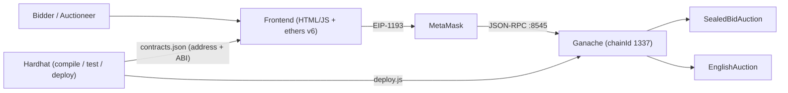

# 02 · Kiến trúc hệ thống & Thiết kế

## 1. Bối cảnh hệ thống



- **Off-chain**: sinh `secret` 32 byte, tính commitment, lưu secret (localStorage + file JSON).
- **On-chain**: chỉ lưu commitment + deposit tới pha Reveal; xác minh hash khi reveal.

## 2. Cơ chế Commit-Reveal

| Pha | Người dùng gửi | Contract làm |
|---|---|---|
| Bidding (`t < biddingEnd`) | `commitBid(C)` + `msg.value = deposit` | Lưu `Bid{C, deposit, revealed=false}`, cộng `unrevealedDeposits` |
| Reveal (`biddingEnd ≤ t < revealEnd`) | `revealBid(value, secret)` | Kiểm `keccak256(value, secret, msg.sender, this) == C`, `deposit ≥ value`; cập nhật giá cao nhất; ghi phần thừa vào `pendingReturns` |
| Ended (`t ≥ revealEnd`) | `auctionEnd()` (ai cũng gọi được) | `pendingReturns[beneficiary] += highestBid + unrevealedDeposits` |
| Mọi lúc | `withdraw()` | Chuyển `pendingReturns[msg.sender]` (Pull-Payment) |

### 2.1 Công thức commitment

```
C = keccak256(abi.encodePacked(uint256 value, bytes32 secret, address bidder, address auction))
```

- **Vì sao thêm `bidder`**: nếu chỉ `keccak256(value, secret)`, kẻ tấn công copy `C` của Alice từ mempool/chain rồi commit lại; khi Alice reveal, `(value, secret)` lộ ra và kẻ đó reveal theo → bid "ăn theo" với chi phí 0 thông tin. Bind `msg.sender` khiến commit copy không bao giờ khớp.
- **Vì sao thêm `address(this)`**: chặn replay commitment/secret giữa hai phiên đấu giá khác nhau.
- **`abi.encodePacked` an toàn ở đây**: mọi tham số kích thước cố định (32/32/20/20 byte) → không có va chạm do nối chuỗi động.
- `secret` phải ngẫu nhiên 32 byte (`ethers.randomBytes(32)`); secret yếu + `value` có không gian nhỏ → brute-force được.

### 2.2 Che giấu giá bằng deposit > value

Deposit là công khai. Nếu `deposit == value`, giá lộ ngay ở pha Bidding. Cho phép `deposit ≥ value` và khuyến khích đặt cọc dư → quan sát viên chỉ biết **cận trên** của giá. Phần dư hoàn qua `pendingReturns` ngay khi reveal.

### 2.3 Chính sách bid không reveal: **tịch thu (forfeit)**

Cọc của bid không reveal chuyển cho beneficiary khi `auctionEnd()`.

- *Lý do (game theory)*: nếu được hoàn cọc, bidder có "quyền chọn miễn phí" — commit nhiều mức rồi chỉ reveal khi có lợi, hoặc commit giả để gây nhiễu. Forfeit biến việc không reveal thành hành động có chi phí → chiến lược trội là reveal trung thực.
- *Đánh đổi*: người dùng quên secret mất cọc → frontend bắt buộc lưu secret trước khi gửi giao dịch và cho tải file backup.

## 3. Máy trạng thái (FSM)

Pha **suy ra** từ thời gian + cờ, không lưu biến `phase` và không cần owner chuyển pha:

```
currentPhase():
  cancelled                     -> Cancelled
  ended || t >= revealEnd       -> Ended
  t >= biddingEnd               -> Reveal
  else                          -> Bidding
```

Ưu điểm: không có giao dịch "chuyển pha" (tiết kiệm gas, không phụ thuộc owner online), không thể kẹt trạng thái. Guard mỗi hàm dùng modifier `onlyBefore/onlyAfter` với deadline `immutable`. Sơ đồ: [04-diagrams.md §2](04-diagrams.md).

## 4. Pull-over-Push

Contract **không bao giờ** gửi ETH chủ động trong `revealBid`/`auctionEnd`; chỉ ghi sổ `pendingReturns`. Người nhận tự gọi `withdraw()`.

- Chặn DoS: một địa chỉ nhận ETH bị revert (contract không có `receive`) không làm kẹt `revealBid` của người khác.
- Chặn reentrancy: `withdraw()` theo CEI (zero số dư → `call`) + `nonReentrant`.
- `withdraw()` vẫn hoạt động khi `paused` — dừng khẩn cấp không được giam tiền người dùng.

## 5. So sánh Sealed-Bid vs English Auction

| Tiêu chí | Sealed-Bid (Commit-Reveal) | English (mở) |
|---|---|---|
| Tính công khai | Giá ẩn tới Reveal; chỉ lộ cận trên qua deposit | Mọi bid công khai tức thì |
| Front-running / MEV | Cao: bot không đọc được giá trong mempool; thứ tự reveal không ảnh hưởng kết quả | Thấp: bot thấy bid trong mempool, chèn bid cao hơn `minIncrement` ở block cuối (sniping) |
| Số giao dịch / bidder | ≥ 3 (commit, reveal, withdraw) | 1 / lần nâng giá + withdraw nếu bị vượt |
| Gas | Cao hơn / bidder (2 SSTORE commit + reveal); xem [06](06-gas-optimization.md) | Thấp / lượt, nhưng tổng tăng theo số lần nâng giá |
| UX | Phức tạp: phải giữ secret, phải quay lại reveal đúng hạn | Đơn giản |
| Rủi ro người dùng | Mất cọc nếu quên secret/không reveal | Bị sniping phút chót |
| Game theory | Khuyến khích bid theo định giá cá nhân; first-price → có xu hướng "bid shading" (bid thấp hơn định giá). Vickrey (second-price) mới là truthful — ngoài phạm vi | Chiến lược trội: nâng giá tới định giá cá nhân; tâm lý bầy đàn, đẩy giá cảm tính, winner's curse với tài sản giá trị chung |
| Kết thúc | Cố định theo `revealEnd` | Cố định theo `biddingEnd` (không có anti-sniping extension) |

## 6. Quyết định thiết kế (ADR)

| # | Quyết định | Phương án bị loại | Lý do |
|---|---|---|---|
| ADR-01 | Commitment bind `msg.sender` + `address(this)` | `keccak256(value, secret)` như đặc tả gốc | Chặn copy/replay commitment |
| ADR-02 | 1 bid / địa chỉ | Nhiều bid / địa chỉ (mảng) | Đơn giản, tránh vòng lặp; Sybil vẫn có thể dùng nhiều ví — chấp nhận |
| ADR-03 | FSM suy ra từ `block.timestamp` | Owner gọi `startReveal()` | Không phụ thuộc owner, ít giao dịch, không kẹt pha |
| ADR-04 | Pull-Payment cho mọi dòng tiền (kể cả beneficiary) | Push trong `auctionEnd` | Chặn DoS/reentrancy |
| ADR-05 | Bid không reveal bị tịch thu | Hoàn cọc | Loại bỏ "quyền chọn miễn phí" (§2.3) |
| ADR-06 | Bằng giá: người reveal trước giữ (`>` nghiêm ngặt) | Random / người commit trước | Xác định, rẻ gas; thứ tự reveal không đoán trước được giá người khác |
| ADR-07 | OpenZeppelin v5 `Ownable`, `Pausable`, `ReentrancyGuard` | Tự viết | Đã audit, giảm bề mặt lỗi |
| ADR-08 | `Bid{bytes32, uint96, bool}` packing 2 slot | `uint256 deposit` (3 slot) | Tiết kiệm 1 SSTORE mới (~20k gas) mỗi commit; `uint96` đủ ~7.9e10 ETH |
