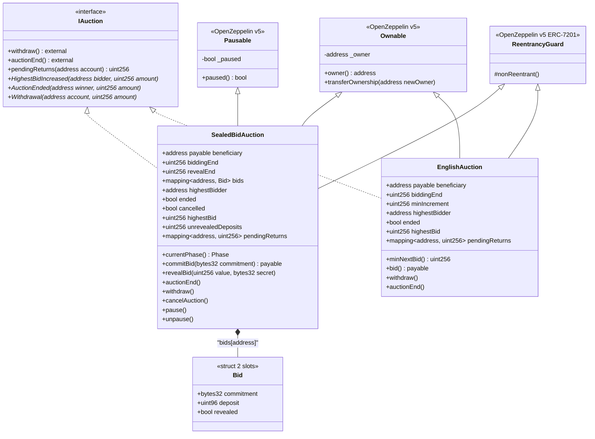
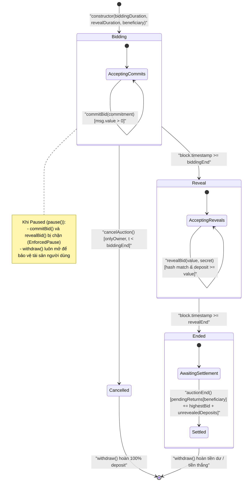
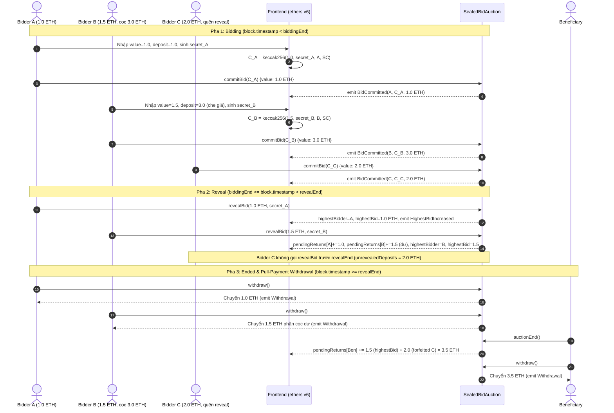
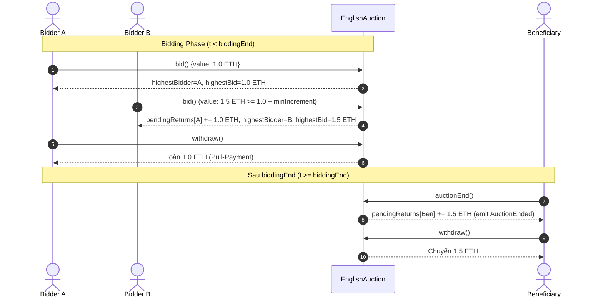
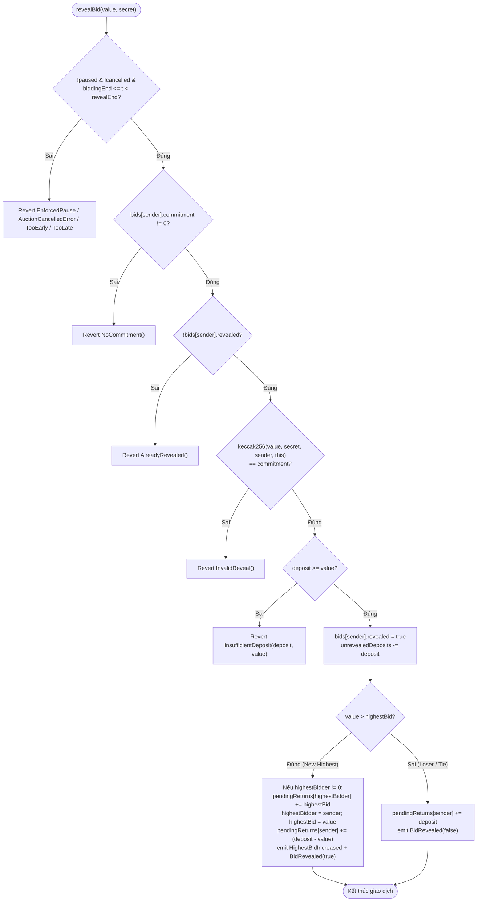

# 04 · Sơ đồ Kiến trúc & Luồng Hoạt động (Mermaid v11 Diagrams)

Tài liệu tập hợp toàn bộ sơ đồ UML/Mermaid dùng cho thiết kế kỹ thuật và Báo cáo 4–6 trang ([report-outline.md](report/report-outline.md)).

---

## 1. Sơ đồ Lớp Hợp đồng (Contract Class Diagram)

---

## 2. Máy Trạng thái Hữu hạn — SealedBidAuction (State Machine Diagram)

Pha của hợp đồng được suy diễn hàm thuần theo thời gian (`block.timestamp`) kết hợp cờ `ended` / `cancelled`:

---

## 3. Biểu đồ Tuần tự — Luồng Commit-Reveal-Withdraw (Sequence Diagram)

---

## 4. Biểu đồ Tuần tự — EnglishAuction Đối chuẩn

---

## 5. Lưu đồ Xử lý `revealBid(value, secret)` (Control-Flow Flowchart)

