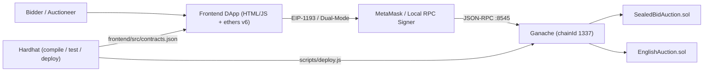
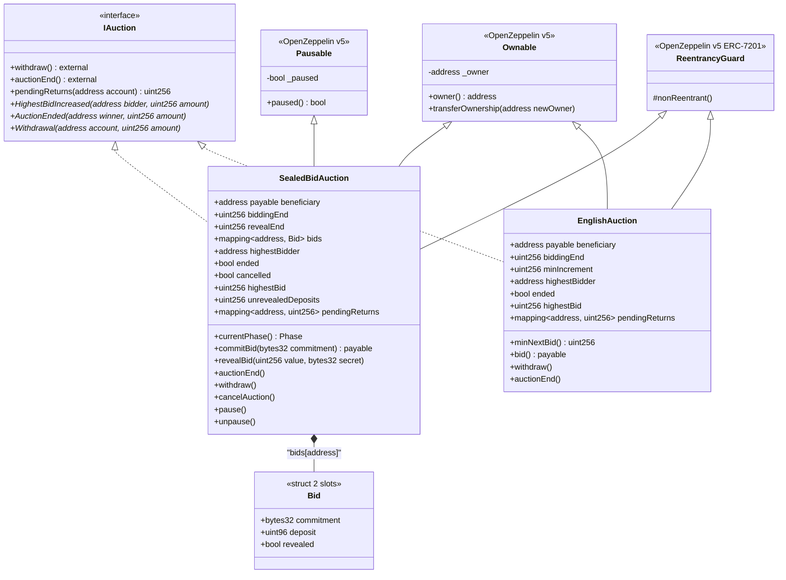
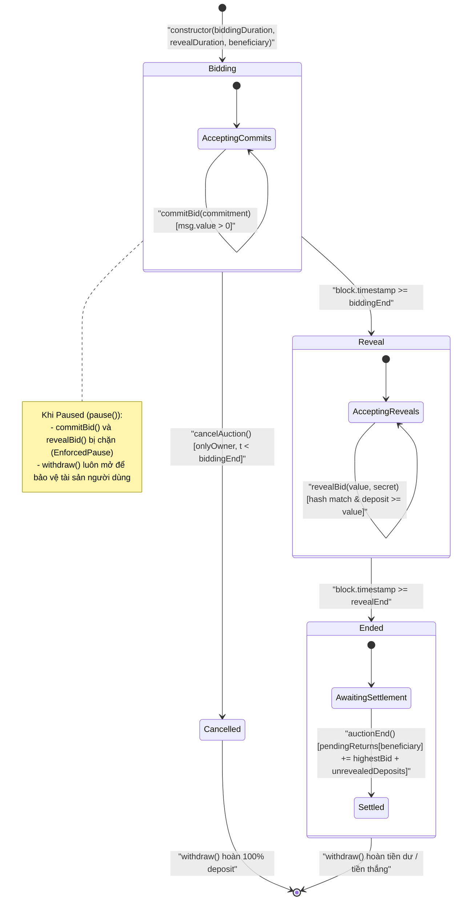
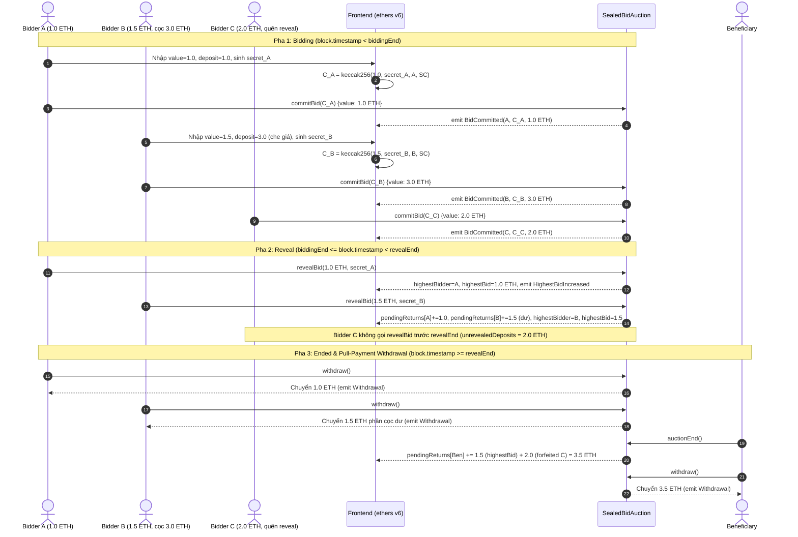
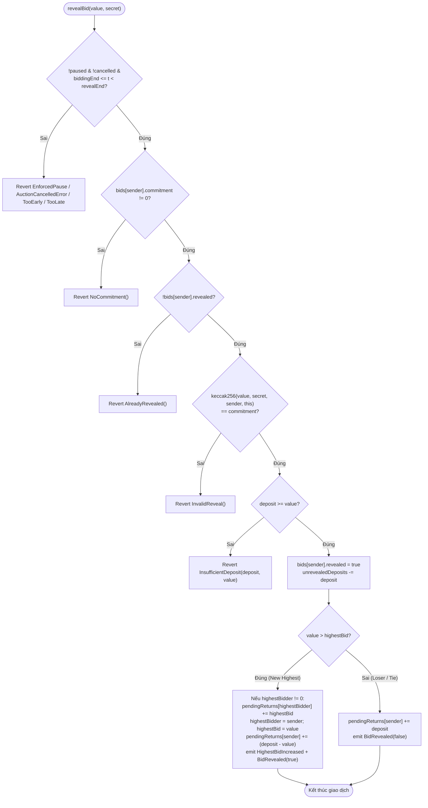

# Báo cáo Kỹ thuật: Hệ thống Đấu giá Kín Phi tập trung (Sealed-Bid Auction) theo Cơ chế Commit-Reveal trên Ethereum

- **Đề tài**: Project 6 — Sealed-Bid Auction (Smart Contract & DApp)
- **Nhóm thực hiện**: Team 21
- **Nền tảng & Công cụ**: Solidity `0.8.24` (EVM target `paris`, Optimizer `200 runs`), OpenZeppelin Contracts `5.x`, Hardhat `2.x`, Ethers.js `v6.13.4`, Ganache (`chainId = 1337`), MetaMask
- **Tài liệu đối chiếu**: [`01-requirements.md`](../01-requirements.md) · [`02-architecture.md`](../02-architecture.md) · [`03-contract-spec.md`](../03-contract-spec.md) · [`04-diagrams.md`](../04-diagrams.md) · [`05-security.md`](../05-security.md) · [`06-gas-optimization.md`](../06-gas-optimization.md) · [`07-test-plan.md`](../07-test-plan.md) · [`08-frontend-spec.md`](../08-frontend-spec.md) · [`09-demo-script.md`](../09-demo-script.md)

---

## 1. Giới thiệu & Bài toán Đấu giá Phi tập trung

### 1.1 Bài toán Minh bạch Cưỡng bức, Front-Running & MEV trên Blockchain Công khai

Đấu giá trực tuyến là một trong những cơ chế phân bổ tài nguyên nền tảng nhất của thương mại điện tử và tài chính phi tập trung (DeFi), từ thanh lý tài sản thế chấp, đấu giá tên miền (ENS), phát hành NFT cho tới đấu thầu quyền khai thác khối. Tuy nhiên, việc triển khai cơ chế đấu giá trực tiếp lên một sổ cái công khai như Ethereum đối mặt với một nghịch lý cốt lõi: **mọi dữ liệu giao dịch đều hiển thị minh bạch trong hàng đợi bộ nhớ (public mempool) trước khi được đưa vào khối**.

Trong mô hình đấu giá mở kiểu Anh truyền thống (`EnglishAuction`), người tham gia gửi giá trả trực tiếp qua `msg.value`. Khi giao dịch của người chơi trung thực (ví dụ Alice đặt `1.5 ETH`) vừa xuất hiện trong mempool:
1. **Tấn công Chặn đầu (Front-Running / MEV Extraction)**: Các bot tìm kiếm lợi nhuận tối đa có thể trích xuất (Maximal Extractable Value — MEV) hoặc chính Validator đọc được định giá của Alice, lập tức phát một giao dịch đặt giá `1.5 ETH + minIncrement` với phí ưu tiên (`maxPriorityFeePerGas`) cao hơn để chèn lên trước trong cùng khối.
2. **Đấu giá Phút chót (Last-Block Sniping)**: Người chơi trì hoãn trả giá tới sát thời điểm `biddingEnd` để đối thủ không kịp phản ứng, biến cuộc đấu giá định giá tài sản thành cuộc đua độ trễ mạng và phí gas.
3. **Lộ thông tin định giá & Hiệu ứng Mỏ neo (Information Leakage & Anchoring)**: Các lượt trả giá sớm tiết lộ chiến lược định giá riêng tư, dẫn tới hành vi ăn theo (free-riding) hoặc đẩy giá cảm tính gây "lời nguyền của người chiến thắng" (*winner's curse*).

Để giải quyết triệt để mâu thuẫn giữa **tính minh bạch xác minh được (verifiable transparency)** của hợp đồng thông minh và **quyền riêng tư về giá (bid confidentiality)** trong giai đoạn đấu thầu, đề tài thiết kế và hiện thực hóa hợp đồng **`SealedBidAuction`** sử dụng giao thức mật mã hai pha **Commit-Reveal** kết hợp cơ chế đặt cọc che giấu giá (`deposit >= value`) và mẫu thanh toán kéo (**Pull-over-Push**). Song song đó, nhóm xây dựng hợp đồng đối chuẩn **`EnglishAuction`** để thực hiện so sánh định lượng về chi phí gas, bề mặt tấn công bảo mật và đặc tính lý thuyết trò chơi.

### 1.2 Mục tiêu & Phạm vi Hệ thống

1. **Hợp đồng `SealedBidAuction`**: Đấu giá kín giá thứ nhất (*first-price sealed-bid auction*) theo cơ chế Commit-Reveal hai pha (`Bidding` và `Reveal`), ẩn hoàn toàn giá thật ngoài chuỗi tới pha mở giá, tự động chuyển pha theo `block.timestamp`, và hoàn trả tiền an toàn qua `withdraw()`.
2. **Hợp đồng `EnglishAuction`**: Đấu giá mở nâng giá tối thiểu `minIncrement` làm cơ sở đối chuẩn thực nghiệm.
3. **Kiểm thử Tự động & Tối ưu hóa Gas**: Xây dựng bộ kiểm thử Mocha/Chai đạt 100% độ bao phủ lệnh và nhánh trên cả 2 hợp đồng; đo lường gas thực tế bằng `hardhat-gas-reporter` và chứng minh hiệu quả trước/sau của 04 kỹ thuật tối ưu hóa cấp độ EVM storage/bytecode.
4. **DApp Frontend Kết nối Kép (Dual-Mode)**: Giao diện HTML5/CSS3/ES Modules thuần tích hợp `ethers.js v6`, hỗ trợ đồng thời ví MetaMask trên mạng Ganache (`chainId 1337`) và chế độ chuyển đổi 4 vai trò trực tiếp qua JSON-RPC phục vụ kiểm thử E2E và trình diễn trực tiếp.

| Trong phạm vi (In-Scope) | Ngoài phạm vi (Out-of-Scope) |
|---|---|
| 1 phiên đấu giá / 1 lần triển khai hợp đồng; tối đa 1 lượt cam kết / địa chỉ ví | Hợp đồng Factory đa phiên; ký gửi tài sản ERC-721 / ERC-1155 |
| Đồng tiền thanh toán & đặt cọc là ETH bản địa (native Ether) | Thanh toán bằng token ERC-20 hoặc đa tiền tệ |
| Mạng cục bộ Ganache / Hardhat Network (`chainId = 1337`) | Triển khai Mainnet, zk-SNARKs hoặc mạng chuyển tiếp riêng tư Flashbots |
| Đấu giá giá thứ nhất (*First-Price Sealed-Bid*: người thắng trả đúng giá mình đặt) | Đấu giá Vickrey (*Second-Price* — phân tích đối chiếu ở góc độ lý thuyết trò chơi) |

---

## 2. Kiến trúc Hệ thống & Thiết kế Hợp đồng

### 2.1 Kiến trúc Tổng thể On-Chain / Off-Chain

Hệ thống phân tách rõ ràng giữa tầng tính toán mật mã cục bộ tại trình duyệt (Off-chain) và tầng lưu trữ, đối soát bất biến trên máy ảo Ethereum (On-chain):



- **Tầng Off-chain (`frontend/src/app.js`, `test/helpers/commit.js`)**: Sinh khóa ngẫu nhiên `secret` 32 byte bằng bộ sinh số ngẫu nhiên an toàn mật mã (`ethers.randomBytes(32)`), tính mã băm cam kết `commitment`, và lưu trữ bền vững cặp `(value, secret)` vào `localStorage` (theo khóa `sba:<contract>:<wallet>`) kèm tệp sao lưu JSON trước khi ký giao dịch.
- **Tầng On-chain (`SealedBidAuction.sol`, `EnglishAuction.sol`)**: Chỉ lưu trữ chuỗi băm `bytes32 commitment` và số tiền ký quỹ `deposit` trong pha `Bidding`; thực hiện kiểm chứng preimage mật mã trong pha `Reveal` và hạch toán số dư chờ rút theo thời gian thực với độ phức tạp $O(1)$.

### 2.2 Cơ chế Commit-Reveal & Thiết kế Hàm Băm Chống Sao chép

Vòng đời của một phiên đấu giá kín diễn ra qua 4 giai đoạn tác vụ rõ rệt:

| Pha hoạt động | Điều kiện thời gian | Tác vụ của Người dùng | Xử lý Trạng thái tại Hợp đồng (`SealedBidAuction`) |
|---|---|---|---|
| **1. Bidding** | `t < biddingEnd` | Gọi `commitBid(C)` kèm `msg.value = deposit` | Kiểm tra `C != 0`, `deposit > 0`, chưa commit; lưu `Bid{C, uint96(deposit), false}`; cộng `unrevealedDeposits += deposit` |
| **2. Reveal** | `biddingEnd <= t < revealEnd` | Gọi `revealBid(value, secret)` | Kiểm tra `keccak256(value, secret, msg.sender, address(this)) == C` và `deposit >= value`; trừ `unrevealedDeposits`; cập nhật `highestBid` và cộng phần tiền dư/hoàn vào `pendingReturns` |
| **3. Ended** | `t >= revealEnd` | Bất kỳ ai gọi `auctionEnd()` | Đánh dấu `ended = true`; kết chuyển `pendingReturns[beneficiary] += highestBid + unrevealedDeposits`; đặt `unrevealedDeposits = 0` |
| **4. Withdrawal** | Mọi thời điểm | Người có số dư gọi `withdraw()` | Đọc `amount = pendingReturns[msg.sender]` (+ `deposit` nếu `cancelled`), xóa số dư về `0`, chuyển ETH qua `.call{value: amount}("")` |

#### Công thức Cam kết Mật mã (Cryptographic Commitment Formula)

Thay vì chỉ băm đơn thuần `(value, secret)` như các cài đặt sơ khai, hợp đồng ràng buộc chặt chẽ **địa chỉ người đặt giá (`msg.sender`)** và **địa chỉ hợp đồng phiên đấu giá (`address(this)`)** vào chuỗi byte đầu vào:

$$\text{commitment} = \text{keccak256}\left(\text{abi.encodePacked}(\text{uint256 value},\ \text{bytes32 secret},\ \text{address msg.sender},\ \text{address(this)})\right)$$

1. **Chặn đứng tấn công Sao chép Cam kết (Commit-Copy Attack)**: Nếu công thức chỉ là `keccak256(value, secret)`, kẻ tấn công Eve có thể quan sát giao dịch `commitBid(C_Alice)` của Alice trên chuỗi rồi gửi ngay một giao dịch `commitBid(C_Alice)` với cùng chuỗi băm `C_Alice`. Khi bước sang pha Reveal, ngay khi Alice gửi `revealBid(value, secret)`, cặp `(value, secret)` lộ diện công khai; Eve lập tức sao chép cặp này để reveal hợp lệ mà không cần định giá trước. Khi đưa `msg.sender` vào trong hàm băm, preimage khi Eve gọi `revealBid` sẽ dùng `msg.sender = Eve != Alice`, tạo ra mã băm hoàn toàn khác và bị hợp đồng từ chối với lỗi `InvalidReveal()` (được kiểm chứng tự động tại `TC-SB-08`).
2. **Chặn tấn công Phát lại Liên hợp đồng (Cross-Contract Replay)**: Việc đưa `address(this)` vào preimage đảm bảo một cam kết hợp lệ ở phiên đấu giá A không thể bị tái sử dụng ở phiên đấu giá B ngay cả khi người dùng dùng lại cùng `secret`.
3. **Tính an toàn của `abi.encodePacked`**: Cả 4 đối số đầu vào đều có độ dài byte cố định tuyệt đối (`32 bytes` + `32 bytes` + `20 bytes` + `20 bytes` = `104 bytes`), loại bỏ hoàn toàn nguy cơ va chạm băm do dịch chuyển ranh giới kiểu dữ liệu động (*hash collision on dynamic types*).

#### Cơ chế Che giấu Giá bằng Tiền cọc Dư (`deposit >= value`)

Trên Ethereum, trường `msg.value` của mọi giao dịch luôn hiển thị công khai. Nếu bắt buộc `deposit == value`, giá đấu thầu sẽ bị lộ ngay lập tức ở pha `Bidding`, làm vô hiệu hóa ý nghĩa của hàm băm. Do đó, hợp đồng cho phép người chơi gửi `deposit >= value` (ví dụ: giá thật `value = 1.5 ETH` nhưng gửi `deposit = 3.0 ETH`). Khi đó, kẻ quan sát chỉ biết **cận trên** của giá trả ($\text{value} \le \text{deposit}$). Ngay khi người chơi gọi `revealBid` hợp lệ:
- Nếu dẫn đầu (`value > highestBid`): phần cọc chênh lệch `deposit - value` được cộng ngay vào `pendingReturns[msg.sender]`, còn `highestBid` cũ được hoàn vào `pendingReturns[previousHighestBidder]`.
- Nếu thua cuộc hoặc bằng giá (`value <= highestBid`): toàn bộ `deposit` được cộng ngay vào `pendingReturns[msg.sender]`.

### 2.3 Máy Trạng thái Hữu hạn Suy diễn theo Thời gian (Timestamp-Driven FSM)

Hợp đồng không lưu trữ biến trạng thái `phase` trong storage mà suy diễn hàm thuần (`view`) thông qua `currentPhase()` dựa trên `block.timestamp` và hai cờ boolean `cancelled`, `ended`:

```solidity
function currentPhase() public view returns (Phase) {
    if (cancelled) return Phase.Cancelled;
    if (ended || block.timestamp >= revealEnd) return Phase.Ended;
    if (block.timestamp >= biddingEnd) return Phase.Reveal;
    return Phase.Bidding;
}
```

Thiết kế này mang lại 3 ưu thế vượt trội: (1) **Tiết kiệm gas**: không tốn giao dịch `SSTORE` chỉ để chuyển pha từ `Bidding` sang `Reveal` hay sang `Ended`; (2) **Chống kẹt trạng thái (Liveness)**: quá trình chuyển pha diễn ra tức thì theo thời gian thực của chuỗi khối mà không phụ thuộc vào việc `owner` có trực tuyến để bấm nút chuyển pha hay không; (3) **Kiểm soát chặt bằng Modifier**: mỗi hàm tác vụ được bảo vệ bởi `onlyBefore(deadline)` và `onlyAfter(deadline)` đối chiếu trực tiếp với các mốc thời gian `immutable`.

### 2.4 Mẫu Thiết kế Pull-over-Push & Bố cục Lưu trữ (Storage Layout)

Hợp đồng tuân thủ tuyệt đối nguyên tắc **không bao giờ tự động đẩy (push) ETH cho bất kỳ địa chỉ nào trong quá trình `revealBid` hoặc `auctionEnd`**. Mọi khoản hoàn tiền hoặc thanh toán doanh thu đều được ghi nhận nội bộ vào `mapping(address => uint256) public pendingReturns`, và người nhận chủ động gọi `withdraw()`. Đáng chú ý, hàm `withdraw()` **không** gắn modifier `whenNotPaused`, đảm bảo ngay cả khi `owner` kích hoạt chế độ dừng khẩn cấp (`pause()`), người dùng vẫn luôn rút được tài sản hợp pháp của mình.

Về bố cục bộ nhớ (Storage Layout), hợp đồng `SealedBidAuction` tối ưu hóa việc sắp xếp các biến trạng thái và cấu trúc `struct Bid`:

| Slot | Biến trạng thái | Kiểu dữ liệu & Kích thước | Cơ chế tối ưu hóa EVM Storage |
|---|---|---|---|
| `0` | `_owner` + `_paused` | `address` (20B) + `bool` (1B) | Kế thừa từ OpenZeppelin `Ownable` và `Pausable`, đóng gói chung trong 1 slot (21/32 bytes) |
| `1` | `bids` | `mapping(address => Bid)` | Mỗi phần tử `Bid` chỉ chiếm **2 slots** (`bytes32 commitment` ở slot $k$; `uint96 deposit` 12B + `bool revealed` 1B ở slot $k+1$) |
| `2` | `highestBidder` + `ended` + `cancelled` | `address` (20B) + `bool` (1B) + `bool` (1B) | Ba biến trạng thái cốt lõi đóng gói khít vào **1 slot duy nhất** (22/32 bytes) |
| `3` | `highestBid` | `uint256` (32B) | Giá trả hợp lệ cao nhất hiện tại |
| `4` | `unrevealedDeposits` | `uint256` (32B) | Tổng số tiền cọc của các cam kết chưa được mở |
| `5` | `pendingReturns` | `mapping(address => uint256)` | Sổ cái số dư chờ rút theo mẫu Pull-Payment |
| Bytecode | `beneficiary`, `biddingEnd`, `revealEnd` | `immutable` | Nhúng trực tiếp vào runtime bytecode khi khởi tạo, tốn `0` storage slot và giảm chi phí đọc từ `2,100` gas (`SLOAD` cold) xuống `3` gas (`PUSH32`) |
| ERC-7201 | `_status` (`ReentrancyGuard`) | `uint256` (Namespaced Slot) | Slot lưu trữ độc lập chuẩn ERC-7201 của OpenZeppelin v5 |

### 2.5 So sánh Đối chuẩn: Sealed-Bid Auction vs English Auction

| Tiêu chí Đối chiếu | `SealedBidAuction` (Commit-Reveal) | `EnglishAuction` (Đấu giá mở truyền thống) |
|---|---|---|
| **Tính bảo mật thông tin giá** | Giá thật ẩn hoàn toàn tới pha `Reveal`; chỉ lộ cận trên thông qua `deposit` | Mọi lượt trả giá đều công khai tức thì trên mempool và sổ cái |
| **Khả năng chống Front-running / MEV** | **Rất cao**: Bot không thể đọc `value` từ `bytes32 commitment`; thứ tự mở giá ở pha `Reveal` không thay đổi người thắng (trừ khi đồng giá) | **Thấp**: Dễ bị bot MEV chèn giao dịch trả cao hơn `minIncrement` hoặc bị sniping ở block cuối cùng |
| **Số lượng giao dịch / Người chơi** | Cố định `2` giao dịch ghi trạng thái (`commitBid`, `revealBid`) + `1` giao dịch `withdraw` | Tối thiểu `1` giao dịch `bid()`, nhưng tăng tuyến tính ($k$ lần) khi có cạnh tranh trả giá qua lại |
| **Hiệu quả Chi phí Gas** | Tốn `~206,937` gas cố định cho chu kỳ 3 bước; **rẻ hơn English Auction từ lượt trả giá thứ 3 trở đi ($k \ge 3$)** | Tốn `~60,588` gas / lượt `bid` + `32,398` gas `withdraw`; điểm hòa vốn tại $k^* \approx 2.88$ lượt trả giá |
| **Trải nghiệm Người dùng (UX)** | Yêu cầu quản lý `secret` và quay lại mở giá đúng khung giờ `Reveal` | Trực quan, chỉ cần gửi 1 giao dịch trả giá duy nhất mỗi lượt |
| **Đặc tính Lý thuyết Trò chơi** | Người chơi định giá độc lập, chống tâm lý bầy đàn; tồn tại xu hướng *bid shading* (trả thấp hơn định giá thực một chút để tối ưu lợi nhuận kỳ vọng) | Chiến lược trội là nâng giá dần tới mức sẵn lòng trả tối đa; dễ dẫn tới *winner's curse* đối với tài sản có giá trị chung |

### 2.6 Các Quyết định Thiết kế Kiến trúc (ADR-01..08) & Hệ Bất biến (`INV-1..7`)

| Mã ADR | Quyết định Thiết kế | Phương án Thay thế bị Loại bỏ | Lý do Kỹ thuật & Bảo mật |
|---|---|---|---|
| **ADR-01** | Ràng buộc `msg.sender` và `address(this)` vào hash cam kết | Chỉ băm `keccak256(value, secret)` | Triệt tiêu hoàn toàn tấn công sao chép cam kết (Commit-Copy) và phát lại liên hợp đồng |
| **ADR-02** | Giới hạn 1 cam kết / địa chỉ ví | Cho phép 1 địa chỉ gửi mảng nhiều bid | Giữ cấu trúc dữ liệu phẳng $O(1)$, loại bỏ vòng lặp duyệt mảng dễ gây DoS vượt giới hạn gas |
| **ADR-03** | Suy diễn pha tự động từ `block.timestamp` | Owner gọi hàm `AdvancePhase()` thủ công | Loại bỏ chi phí gas chuyển pha và rủi ro hợp đồng bị treo khi Owner mất kết nối |
| **ADR-04** | Áp dụng Pull-Payment cho mọi dòng tiền (kể cả `beneficiary`) | Tự động `transfer` tiền thắng trong `auctionEnd()` | Ngăn chặn hợp đồng `beneficiary` lỗi/độc hại làm revert `auctionEnd()` và khóa tiền hệ thống |
| **ADR-05** | Tịch thu tiền cọc (`forfeit`) của các cam kết không mở | Cho phép rút lại cọc nếu quên reveal | Loại bỏ "quyền chọn miễn phí" (*free option griefing*) trong lý thuyết trò chơi |
| **ADR-06** | Quy tắc phá vỡ thế hòa (Tie-break): ưu tiên người reveal trước (`>`) | Chia đôi hoặc chọn người commit trước | Thực thi đơn giản với 1 phép so sánh `value > highestBid`, tiết kiệm SSTORE và xác định 100% |
| **ADR-07** | Kế thừa OpenZeppelin v5 (`Ownable`, `Pausable`, `ReentrancyGuard`) | Tự viết các biến khóa và kiểm tra quyền | Tận dụng mã nguồn chuẩn công nghiệp đã qua kiểm toán và hỗ trợ Custom Errors sẵn có |
| **ADR-08** | Đóng gói `struct Bid` vào 2 storage slots (`uint96` + `bool`) | Dùng `uint256 deposit` (chiếm 3 slots) | Giảm 1 lệnh `SSTORE` zero-to-nonzero (`~20,000` gas) khi reveal; `uint96` chứa được $\approx 79.2\text{ tỷ ETH}$ |

Hệ thống duy trì **07 bất biến trạng thái (`INV-1..7`)** trong mọi bước chuyển:
- **INV-1 (Bảo toàn Thanh khoản)**: $\text{address(this).balance} \ge \sum_{a} \text{pendingReturns}[a] + \text{unrevealedDeposits} + (\text{ended} \ ? \ 0 : \text{highestBid})$.
- **INV-2 (Đối khớp Tiền cọc Chưa mở)**: $\text{unrevealedDeposits} = \sum_{\{a \mid \neg \text{bids}[a].\text{revealed}\}} \text{bids}[a].\text{deposit}$ (khi chưa kết thúc/hủy).
- **INV-3 (Tính nhất quán Người dẫn đầu)**: $\text{highestBidder} = \text{address}(0) \iff \text{highestBid} = 0$.
- **INV-4 (Tính khả thi Thanh toán)**: $\text{highestBid} \le \text{bids}[\text{highestBidder}].\text{deposit}$.
- **INV-5 (Tính đơn điệu Kết thúc)**: Cờ `ended` chỉ chuyển từ `false` sang `true` tối đa 1 lần; `cancelled` và `ended` không bao giờ đồng thời bằng `true`.
- **INV-6 (Tính duy nhất mỗi Địa chỉ)**: Mỗi địa chỉ gọi thành công `commitBid` tối đa 1 lần và `revealBid` tối đa 1 lần.
- **INV-7 (Độ phức tạp Hằng số)**: Không có bất kỳ hàm nào chứa vòng lặp phụ thuộc số lượng người tham gia ($O(1)$ gas/lời gọi).

---

## 3. Sơ đồ Thiết kế Hợp đồng (UML / Mermaid v11)

### 3.1 Sơ đồ Lớp Hợp đồng (Contract Class Diagram)



### 3.2 Máy Trạng thái Hữu hạn — `SealedBidAuction` (FSM State Diagram)



### 3.3 Biểu đồ Tuần tự — Luồng Commit-Reveal-Withdraw (Sequence Diagram)



### 3.4 Lưu đồ Xử lý Hàm `revealBid(value, secret)` (Control-Flow Flowchart)



---

## 4. Phân tích Bảo mật (Security Considerations)

### 4.1 Ma trận Mô hình Đe dọa & Cơ chế Giảm thiểu (`T-01..T-10`)

| Mã | Mối đe dọa (Threat) | Kịch bản Tấn công | Tác động | Cơ chế Phòng vệ trong Hợp đồng | Rủi ro Còn lại & Kiểm chứng |
|---|---|---|---|---|---|
| **T-01** | **Reentrancy** (Tái nhập khi rút tiền) | Hợp đồng độc hại gọi `withdraw()` và trong `receive()` gọi đệ quy lại `withdraw()` trước khi số dư bị trừ | Rút cạn toàn bộ ETH của hợp đồng | 1. Mẫu **Pull-over-Push** tách biệt `withdraw()`.<br>2. Mẫu **CEI**: gán `pendingReturns[msg.sender] = 0` trước khi gọi `.call{value}()`.<br>3. Modifier `nonReentrant` (OpenZeppelin v5 ERC-7201). | **0** — Đã kiểm chứng bằng hợp đồng `ReentrancyAttacker` tại `TC-SB-18`. |
| **T-02** | **Front-Running / MEV** | Bot đọc mempool thấy giá trả của người chơi và chèn giao dịch trả cao hơn | Người chơi thật thua ở block cuối hoặc chịu chi phí cao | `commitBid` chỉ nhận `bytes32 commitment` + `deposit`; giá `value` được giữ bí mật tới pha `Reveal`, nơi mọi cam kết đã khóa. | `deposit` tiết lộ cận trên của giá; giảm thiểu bằng việc đặt `deposit > value`. |
| **T-03** | **Commit-Copy / Replay Attack** | Kẻ tấn công sao chép nguyên `commitment` của Alice ở pha `Bidding` rồi dùng `(value, secret)` của Alice khi Alice mở giá | Ăn theo thông tin định giá hoặc chiếm quyền ưu tiên | Công thức băm ràng buộc cứng `msg.sender` và `address(this)`: `keccak256(abi.encodePacked(value, secret, msg.sender, address(this)))`. | **0** — Kiểm chứng tự động tại `TC-SB-08` (revert `InvalidReveal()`). |
| **T-04** | **Denial of Service (DoS)** qua vòng lặp hoặc Push Refund | Hợp đồng bidder luôn `revert` trong `receive()` làm kẹt hàm hoàn tiền hàng loạt hoặc vượt Block Gas Limit | Đóng băng vĩnh viễn phiên đấu giá | Độ phức tạp mọi hàm là $O(1)$ (không dùng mảng/vòng lặp); mọi khoản hoàn trả ghi vào `pendingReturns` để từng tài khoản tự rút. | **0** — Kiểm chứng bằng hợp đồng `EthRejecter` và bất biến `INV-7`. |
| **T-05** | **Free-Option Griefing** (Đặt cọc ảo không mở) | Kẻ tấn công commit nhiều mức giá khác nhau rồi chỉ mở mức có lợi hoặc bỏ mặc không reveal | Thao túng kết quả và làm méo mó tâm lý thị trường | Toàn bộ tiền cọc không mở (`unrevealedDeposits`) bị **tịch thu (forfeited)** chuyển cho `beneficiary` khi `auctionEnd()`. | Người dùng quên `secret` mất cọc; giảm thiểu bằng lưu tự động `localStorage` + tải file JSON backup trên UI. |
| **T-06** | **Thao túng `block.timestamp`** | Validator dịch chuyển nhãn thời gian khối trong biên độ $\sim 12\text{–}15\text{ giây}$ sát mốc `biddingEnd` / `revealEnd` | Can thiệp biên đóng/mở pha | Cấu hình `biddingDuration` và `revealDuration` đủ lớn (từ vài phút đến hàng giờ trên thực tế, $\gg 15\text{s}$). | Không đặt thời lượng pha $< 60\text{ giây}$ trên mạng sản xuất. |
| **T-07** | **Brute-Force Hash Commitment** | Vét cạn các mệnh giá ETH phổ biến nếu `secret` ngắn hoặc ít entropy | Lộ giá đấu thầu ngay trong pha `Bidding` | Sử dụng `bytes32 secret` sinh từ CSPRNG (`ethers.randomBytes(32)` — 256-bit entropy). | **0** khi dùng bộ sinh khóa chuẩn của DApp/helper. |
| **T-08** | **Tràn số & Ép kiểu `uint96`** | Gửi `msg.value >= 2^96` làm tràn trường `uint96 deposit` khi đóng gói struct | Ghi nhận thiếu tiền cọc, lệch sổ cái | Solidity `0.8.24` kiểm tra tràn số học mặc định; sử dụng `SafeCast.toUint96(msg.value)` từ OpenZeppelin v5. | **0** ($2^{96}\text{ wei} \approx 79.2\text{ tỷ ETH}$, lớn gấp $>650$ lần tổng cung ETH). |
| **T-09** | **Forced Ether (`selfdestruct` / coinbase)** | Ép nạp ETH vào hợp đồng không qua hàm `payable` nhằm phá vỡ biểu thức kiểm tra số dư | Làm kẹt logic nếu hợp đồng dùng đẳng thức `address(this).balance == ...` | Kế toán nội bộ hoàn toàn độc lập qua `highestBid`, `unrevealedDeposits`, `pendingReturns`; không dùng `address(this).balance` trong câu lệnh điều kiện. | **0** (Bất biến `INV-1` duy trì quan hệ $\ge$). |
| **T-10** | **Lạm quyền Quản trị (Admin Abuse)** | `owner` hủy phiên sau khi đã thấy giá ở pha `Reveal`, hoặc gọi `pause()` để giam tiền người chơi | Mất tính phi tập trung, chiếm đoạt hoặc khóa thanh khoản | 1. `cancelAuction()` bị khóa bởi `onlyBefore(biddingEnd)`.<br>2. `withdraw()` không gắn `whenNotPaused`, luôn cho phép rút tiền khi đang tạm dừng. | Kiểm chứng tại `TC-SB-11`, `TC-SB-16`, `TC-SB-17`. |

### 4.2 Phân tích Sâu theo Khung STRIDE & Lý thuyết Trò chơi

- **Phòng chống Tái nhập đa tầng (Defense-in-Depth Reentrancy Protection)**: Trong `withdraw()`, toàn bộ trạng thái (`pendingReturns[msg.sender] = 0` và `b.revealed = true` nếu phiên bị hủy) được cập nhật hoàn tất trước lệnh tương tác ngoại vi `(bool ok, ) = payable(msg.sender).call{value: amount}("")`. Kết hợp thêm khóa `nonReentrant` lưu tại slot độc lập ERC-7201, bất kỳ lời gọi tái nhập nào từ `receive()`/`fallback()` đều bị chặn ngay lập tức với lỗi `ReentrancyGuardReentrantCall()` (hoặc `NothingToWithdraw()`).
- **Giải trình Lý thuyết Trò chơi cho Chính sách Tịch thu Cọc (`unrevealedDeposits` Forfeiture)**: Giả sử hợp đồng cho phép người không reveal được hoàn lại tiền cọc sau `revealEnd`. Khi đó, một kẻ tấn công có vốn lớn có thể tạo $m$ địa chỉ ví để cam kết $m$ mức giá trải đều từ thấp đến cao $v_1 < v_2 < \dots < v_m$. Sang pha `Reveal`, người này chờ tới sát cuối giờ để quan sát mức giá cao nhất hiện tại $H$ của các đối thủ trung thực, rồi **chỉ mở duy nhất ví có giá $v_i$ vừa đủ thắng $H$** và rút lại toàn bộ tiền cọc của $m-1$ ví còn lại mà không chịu bất kỳ tổn thất nào (*free-option attack*). Bằng cách tịch thu 100% tiền cọc của mọi cam kết không mở và chuyển cho `beneficiary` khi `auctionEnd()`, chi phí kỳ vọng của hành vi bỏ mở giá bằng chính toàn bộ khoản ký quỹ `deposit`, biến việc **cam kết đúng 1 mức giá trung thực và mở giá đúng hạn** thành chiến lược trội nghiêm ngặt (*strictly dominant strategy*).

---

## 5. Phân tích & Tối ưu hóa Chi phí Gas

### 5.1 Bảng Chi phí Gas Thực nghiệm theo Hàm (`AC-GAS-01`)

Số liệu được trích xuất từ `hardhat-gas-reporter` (`docs/evidence/gas-report.txt`) trên trình biên dịch Solidity `0.8.24` (`optimizer: true, runs: 200`, EVM `paris`) qua 28 kịch bản kiểm thử:

| Hợp đồng | Hàm / Thao tác | Min Gas | Max Gas | Avg Gas | Số lời gọi | Giải thích Kỹ thuật về Độ lệch Min / Max (theo EIP-2929 & EIP-3529) |
|---|---|---:|---:|---:|---:|---|
| `SealedBidAuction` | `deploy` | `1,059,725` | `1,059,725` | `1,059,725` | `18` | Khởi tạo `Ownable`, `Pausable`, `ReentrancyGuard` và nhúng 3 biến `immutable` (`1.8%` giới hạn khối) |
| `SealedBidAuction` | `commitBid(bytes32)` | `77,683` | `94,795` | `88,846` | `23` | Lần commit đầu tiên khởi tạo `unrevealedDeposits` từ `0 -> non-zero` tốn thêm `+17,100` gas (`20,000` vs `2,900` gas); dao động $\pm 12$ gas ở Min do byte `0x00` trong calldata (EIP-2028) |
| `SealedBidAuction` | `revealBid(uint256,bytes32)` | `60,807` | `107,447` | `82,154` | `16` | **Max (`107,447`)** khi phá kỷ lục `highestBid` (ghi mới `highestBid`, `highestBidder`, cộng `pendingReturns`); **Min (`60,807`)** khi bid thua và chỉ hoàn cọc |
| `SealedBidAuction` | `auctionEnd()` | `49,731` | `54,921` | `52,445` | `5` | Ghi `ended = true` (chung slot với `highestBidder`), cộng `pendingReturns[beneficiary]`, xóa `unrevealedDeposits = 0` (nhận `4,800` gas refund EIP-3529) |
| `SealedBidAuction` | `withdraw()` | `34,494` | `42,428` | `35,937` | `22` | **Min (`34,494`)** khi rút `pendingReturns` thông thường (nhận `4,800` gas refund khi xóa slot về `0`); **Max (`42,428`)** khi rút cọc sau `cancelAuction()` |
| `SealedBidAuction` | `cancelAuction()` | `46,557` | `46,557` | `46,557` | `2` | Kiểm tra `onlyOwner`, ghi `cancelled = true` và phát sự kiện `AuctionCancelled` |
| `SealedBidAuction` | `pause()` | `27,736` | `27,736` | `27,736` | `2` | Ghi cờ `_paused = true` của OpenZeppelin `Pausable` (đóng gói chung slot `0` với `_owner`) |
| `SealedBidAuction` | `unpause()` | `27,707` | `27,707` | `27,707` | `1` | Xóa cờ `_paused = false` (nhận gas refund xóa trạng thái) |
| `EnglishAuction` | `deploy` | `557,325` | `557,325` | `557,325` | `6` | Bytecode nhỏ hơn `47.4%` so với `SealedBidAuction` do không có pha Reveal và `Pausable` (`0.9%` giới hạn khối) |
| `EnglishAuction` | `bid()` | `55,648` | `67,175` | `60,588` | `7` | **Max (`67,175`)** ở lượt trả giá đầu tiên khởi tạo `highestBid` và `highestBidder` (`0 -> non-zero`); **Min (`55,648`)** ở các lượt nâng giá kế tiếp |
| `EnglishAuction` | `auctionEnd()` | `47,224` | `52,517` | `49,871` | `4` | Ghi `ended = true` và kết chuyển `pendingReturns[beneficiary] += highestBid` |
| `EnglishAuction` | `withdraw()` | `32,398` | `32,398` | `32,398` | `12` | Xóa `pendingReturns[msg.sender] = 0` (`4,800` gas refund) và chuyển ETH qua `.call{value}` |

### 5.2 Mô hình Kinh tế Gas & Điểm Hòa vốn ($k^* \approx 2.88$) giữa hai Cơ chế Đấu giá

Xét tổng chi phí gas trung bình mà một người tham gia phải chi trả trong suốt vòng đời phiên đấu giá:
- **Trong `SealedBidAuction`**: Mỗi người chơi luôn thực hiện đúng 1 lệnh `commitBid`, 1 lệnh `revealBid` và 1 lệnh `withdraw` (để rút lại toàn bộ tiền cọc nếu thua, hoặc rút phần tiền cọc dư `deposit - value` nếu thắng và có che giấu giá):
  $$\text{Gas}_{\text{Sealed}}(\text{bidder}) = \underbrace{88,846}_{\text{commitBid}} + \underbrace{82,154}_{\text{revealBid}} + \underbrace{35,937}_{\text{withdraw}} = \mathbf{206,937\text{ gas}}$$
- **Trong `EnglishAuction`**: Nếu cuộc đấu giá diễn ra cạnh tranh và một người chơi phải nâng giá $k$ lượt trước khi rút tiền (`withdraw`):
  $$\text{Gas}_{\text{English}}(k) = k \times 60,588 + 32,398$$

Đặt $\text{Gas}_{\text{English}}(k^*) = \text{Gas}_{\text{Sealed}}$, ta tìm được **điểm hòa vốn số lượt trả giá**:

$$k^* = \frac{206,937 - 32,398}{60,588} = \frac{174,539}{60,588} \approx \mathbf{2.88\text{ lượt trả giá / người}}$$

| Số lượt trả giá ($k$) | Tổng Gas `EnglishAuction` ($k \times 60,588 + 32,398$) | Tổng Gas `SealedBidAuction` (Cố định) | Chênh lệch (`English` $-$ `Sealed`) | Đánh giá Hiệu quả |
|---:|---:|---:|---:|---|
| $k = 1$ | `92,986` gas | `206,937` gas | `-113,951` gas (`-55.07%`) | `EnglishAuction` rẻ hơn khi thị trường ít cạnh tranh (mỗi người trả giá 1 lần) |
| $k = 2$ | `153,574` gas | `206,937` gas | `-53,363` gas (`-25.79%`) | Khoảng cách thu hẹp khi có 1 lượt trả giá đáp trả |
| $k = 3$ | `214,162` gas | `206,937` gas | **`+7,225` gas (`+3.49%`)** | **Vượt ngưỡng hòa vốn ($k \ge 3$)**: `SealedBidAuction` bắt đầu tiết kiệm gas hơn |
| $k = 4$ | `274,750` gas | `206,937` gas | **`+67,813` gas (`+32.77%`)** | `EnglishAuction` tốn kém nhanh chóng theo cường độ chiến tranh giá |

### 5.3 Đánh giá Thực nghiệm Trước / Sau cho 04 Kỹ thuật Tối ưu hóa Gas (`AC-GAS-02`)

Nhóm đã thực hiện đo đối chứng trên cùng kịch bản chuẩn (3 người chơi commit 6 ETH $\to$ 2 người reveal, 1 người bỏ cọc $\to$ `auctionEnd()`, kèm ca kiểm thử revert) giữa hợp đồng `SealedBidAuction` đã tối ưu và các phiên bản baseline chưa áp dụng từng kỹ thuật:

| # | Kỹ thuật Tối ưu hóa | Cấu trúc Trước Tối ưu (Baseline) | Cấu trúc Sau Tối ưu (`SealedBidAuction.sol`) | Trước Tối ưu (Measured) | Sau Tối ưu (Measured) | Tiết kiệm Thực nghiệm (Gas & %) |
|---|---|---|---|---:|---:|---:|
| **1** | **Storage Variable & Struct Packing** | `struct Bid` dùng `uint256 deposit` chiếm 3 slots; `highestBidder`, `ended`, `cancelled` nằm rời ở 3 slots | `struct Bid { bytes32; uint96; bool; }` gói gọn trong **2 slots**; `highestBidder` + `ended` + `cancelled` gói vào **1 slot** (22/32B) | `273,503` gas / chu kỳ (`85,448` commit + `114,080` reveal + `73,975` end) | `229,356` gas / chu kỳ (`83,391` commit + `93,044` reveal + `52,921` end) | **`-44,147` gas (`-16.14%`)**<br>*(Riêng `revealBid` giảm `-18.44%`, `auctionEnd` giảm `-28.46%`)* |
| **2** | **Biến `immutable` cho Cấu hình Phiên** | Lưu `beneficiary`, `biddingEnd`, `revealEnd` trong storage (tốn `SLOAD` cold `2,100` gas mỗi lần đọc) | Khai báo `immutable`, nhúng thẳng vào runtime bytecode (`PUSH32` tốn `3` gas) | `239,859` gas / chu kỳ (`85,494` commit + `97,244` reveal + `57,121` end) | `229,356` gas / chu kỳ (`83,391` commit + `93,044` reveal + `52,921` end) | **`-10,503` gas (`-4.38%`)**<br>*(Tiết kiệm `2,100–4,200` gas mỗi giao dịch)* |
| **3** | **Custom Errors thay Chuỗi `require`** | Dùng `require(cond, "long error string")` lưu chuỗi ASCII trong bytecode và mã hóa ABI động khi revert | Định nghĩa 13 `error CustomError(...)` chỉ mã hóa đúng 4-byte selector | `1,256,192` gas deploy (`30,280` gas tại nhánh revert) | `1,059,725` gas deploy (`30,166` gas tại nhánh revert) | **`-196,467` gas (`-15.64%` deploy)**<br>+ `-114` gas mỗi lần revert |
| **4** | **Storage Caching & Xóa Slot (EIP-3529)** | Đọc lặp `bids[msg.sender].deposit` từ storage; giữ nguyên `unrevealedDeposits` sau khi kết thúc | Cache `uint256 dep = b.deposit` lên stack; gán `unrevealedDeposits = 0` trong `auctionEnd()` để nhận refund `4,800` gas | `148,930` gas (`93,841` reveal + `55,089` end) | `145,965` gas (`93,044` reveal + `52,921` end) | **`-2,965` gas (`-1.99%`)**<br>+ `-42,556` gas deploy (`-3.86%`) |
| **Tổng** | **Kết hợp đồng thời cả 04 kỹ thuật** | **Hợp đồng Baseline chưa tối ưu cả 4 kỹ thuật** | **Hợp đồng `SealedBidAuction` hoàn chỉnh** | **`1,228,904` deploy / `286,978` chu kỳ** | **`1,059,725` deploy / `229,356` chu kỳ** | **`-169,179` deploy (`-13.77%`) / `-57,622` chu kỳ (`-20.08%`)** |

---

## 6. Kiểm thử Tự động, Ứng dụng DApp & Kết luận

### 6.1 Kết quả Kiểm thử Tự động & Độ Bao phủ Mã nguồn (`28/28 Passing`, `100% Coverage`)

Bộ kiểm thử tự động trong [`test/SealedBidAuction.test.js`](../../test/SealedBidAuction.test.js) (22 kịch bản: `TC-SB-00..19` bao gồm `00b`, `00c`) và [`test/EnglishAuction.test.js`](../../test/EnglishAuction.test.js) (6 kịch bản: `TC-EN-00..05`) sử dụng `loadFixture` để cô lập trạng thái từng ca kiểm thử. Toàn bộ bằng chứng đầu ra được lưu trữ nguyên bản tại [`docs/evidence/`](../evidence/):

| Nhóm Kiểm thử | Mã Test Case | Nội dung Kiểm chứng Cốt lõi | Trạng thái |
|---|---|---|---|
| **Khởi tạo & Chuyển pha FSM** | `TC-SB-00`, `00b`, `00c`, `TC-EN-00` | Khởi tạo đúng `owner`, `beneficiary`, `biddingEnd`, `revealEnd`; hàm `currentPhase()` tự động chuyển `Bidding (0) -> Reveal (1) -> Ended (2)` theo `time.increaseTo`; hàm băm phụ thuộc địa chỉ ví | **PASS (4/4)** |
| **Luồng Thành công (Happy Path)** | `TC-SB-01`, `TC-EN-01`, `TC-EN-03` | 3 người chơi commit/bid, mở giá, xác định đúng người thắng và số tiền thắng; đối soát biến động số dư ví chính xác tới từng wei (`changeEtherBalances`) và sự kiện phát ra | **PASS (3/3)** |
| **Chặn Sai Pha Thời gian (`AC-QA-02`)** | `TC-SB-02..05`, `TC-EN-04` | Gọi `commitBid` sau `biddingEnd` (`TooLate`), `revealBid` trước `biddingEnd` (`TooEarly`) hoặc sau `revealEnd` (`TooLate`), `auctionEnd` trước hạn (`TooEarly`) | **PASS (5/5)** |
| **Chặn Gian lận Mở giá (`AC-QA-03`)** | `TC-SB-06..09`, `TC-EN-02` | Mở giá sai `secret` (`InvalidReveal`), khai khống `value` (`InvalidReveal`), sao chép `commitment` của người khác (`InvalidReveal`), đặt cọc thiếu `deposit < value` (`InsufficientDeposit`), trả giá thấp (`BidTooLow`) | **PASS (5/5)** |
| **Phân quyền & Bảo vệ Rút tiền (`AC-QA-04`)** | `TC-SB-10..14`, `TC-EN-05` | Rút tiền khi số dư bằng 0 (`NothingToWithdraw`), người lạ gọi `pause`/`cancelAuction` (`OwnableUnauthorizedAccount`), chống gọi lặp `AlreadyCommitted`, `AlreadyRevealed`, `AuctionAlreadyEnded` | **PASS (6/6)** |
| **Tình huống Biên & Tấn công (`Edge/Security`)** | `TC-SB-15..19` | Tịch thu cọc không mở (`TC-SB-15`), hoàn cọc khi hủy phiên (`TC-SB-16`), rút tiền bình thường khi hợp đồng đang `Paused` (`TC-SB-17`), chặn đứng `ReentrancyAttacker` (`TC-SB-18`), xử lý hòa giá (`TC-SB-19`) | **PASS (5/5)** |

**Bảng Độ Bao phủ Mã nguồn (`solidity-coverage` — [`docs/evidence/coverage-output.txt`](../evidence/coverage-output.txt))**:

| Hợp đồng (`contracts/`) | % Statements (Yêu cầu $\ge 95\%$) | % Branches (Yêu cầu $\ge 90\%$) | % Functions | % Lines | Dòng chưa bao phủ |
|---|---:|---:|---:|---:|---|
| `EnglishAuction.sol` | **100.00%** | **100.00%** | **100.00%** | **100.00%** | Không có |
| `SealedBidAuction.sol` | **100.00%** | **100.00%** | **100.00%** | **100.00%** | Không có |
| **Toàn bộ Hợp đồng (All files)** | **100.00%** | **100.00%** | **100.00%** | **100.00%** | **28 passing (~511ms)** |

### 6.2 Kiến trúc DApp Frontend Kết nối Kép & Kiểm chứng End-to-End

Ứng dụng web tại [`frontend/`](../../frontend/index.html) được xây dựng theo phong cách *Editorial Vault & Ledger* trên nền HTML5, CSS3 và JavaScript ES Modules thuần kết hợp `ethers.js v6.13.4`:
1. **Kiến trúc Kết nối Kép (Dual-Mode Connection)**: Hỗ trợ kết nối mượt mà với ví **MetaMask** (`ethers.BrowserProvider`, tự động chuyển sang mạng Ganache `chainId 1337` qua `wallet_switchEthereumChain`) và tích hợp **Bộ chuyển đổi 4 Vai trò trực tiếp (`#role-selector`)** qua `ethers.JsonRpcProvider("http://127.0.0.1:8545")` (`Role 0`: Owner/Beneficiary, `Role 1`: Bidder A, `Role 2`: Bidder B, `Role 3`: Bidder C). Nhờ đó, người chấm bài hoặc trình duyệt tự động có thể kiểm nghiệm toàn bộ luồng đa người chơi và kiểm tra phân quyền vai trò chỉ bằng một cú nhấp chuột.
2. **Bảo vệ Khóa Bí mật & Giải mã Lỗi Tường minh**: Tự động lưu `(value, secret, commitment)` vào `localStorage` trước khi phát giao dịch `commitBid`, hỗ trợ xuất tệp JSON sao lưu và nạp lại tự động ở pha `Reveal`. Khi giao dịch bị từ chối, hàm `decodeError()` dùng `interface.parseError(data)` để dịch mã lỗi 4-byte thành thông báo tường minh trên thanh `#toast` (như `InvalidReveal()`, `OwnableUnauthorizedAccount(...)`, `NothingToWithdraw()`), đồng thời đồng bộ lịch sử 6 loại sự kiện thời gian thực lên bảng `#event-log`.
3. **Kiểm chứng Kịch bản Tự động (`scripts/demo-scenario.js` — [`docs/evidence/demo-output.txt`](../evidence/demo-output.txt))**: Kịch bản mô phỏng trọn vẹn 4 vai trò: Bidder A đặt `1.0 ETH` (cọc `1.0 ETH`), Bidder B đặt `1.5 ETH` (cọc `3.0 ETH` để che giấu giá), Bidder C đặt `2.0 ETH` (cọc `2.0 ETH`, thử gian lận ở pha Reveal bị chặn bởi `InvalidReveal()` rồi bỏ cuộc). Kết thúc phiên, Bidder B thắng với giá `1.5 ETH` và rút lại `1.5 ETH` cọc dư; Bidder A rút lại đủ `1.0 ETH`; `beneficiary` rút `3.5 ETH` (`1.5 ETH` tiền thắng của B + `2.0 ETH` tiền cọc bị tịch thu của C), đưa số dư hợp đồng về đúng `0.0 ETH` và thỏa mãn tuyệt đối cả 7 bất biến `INV-1..7`.

### 6.3 Kết luận & Hướng Phát triển

Đề tài đã hoàn thành toàn diện mục tiêu thiết kế, hiện thực hóa, tối ưu hóa và kiểm chứng hệ thống đấu giá kín phi tập trung **`SealedBidAuction`** đối sánh cùng **`EnglishAuction`**. Bằng việc kết hợp hàm băm cam kết ràng buộc ngữ cảnh `(value, secret, msg.sender, address(this))`, máy trạng thái thời gian thực, mẫu thanh toán kéo `Pull-over-Push` và 04 kỹ thuật tối ưu hóa bộ nhớ EVM (giảm **13.77%** gas triển khai và **20.08%** gas vòng đời giao dịch), hệ thống vừa triệt tiêu rủi ro Front-Running/MEV, Commit-Copy, Reentrancy và DoS, vừa đạt hiệu quả kinh tế gas vượt trội hơn đấu giá mở ngay từ lượt cạnh tranh giá thứ 3 ($k \ge 3$). Trong tương lai, kiến trúc này có thể mở rộng sang mô hình **Đấu giá Vickrey (Second-Price Sealed-Bid)** hoặc tích hợp bằng chứng không tiết lộ thông tin (**zk-SNARKs**) để loại bỏ hoàn toàn nhu cầu gửi giao dịch mở giá thủ công ở pha Reveal.
